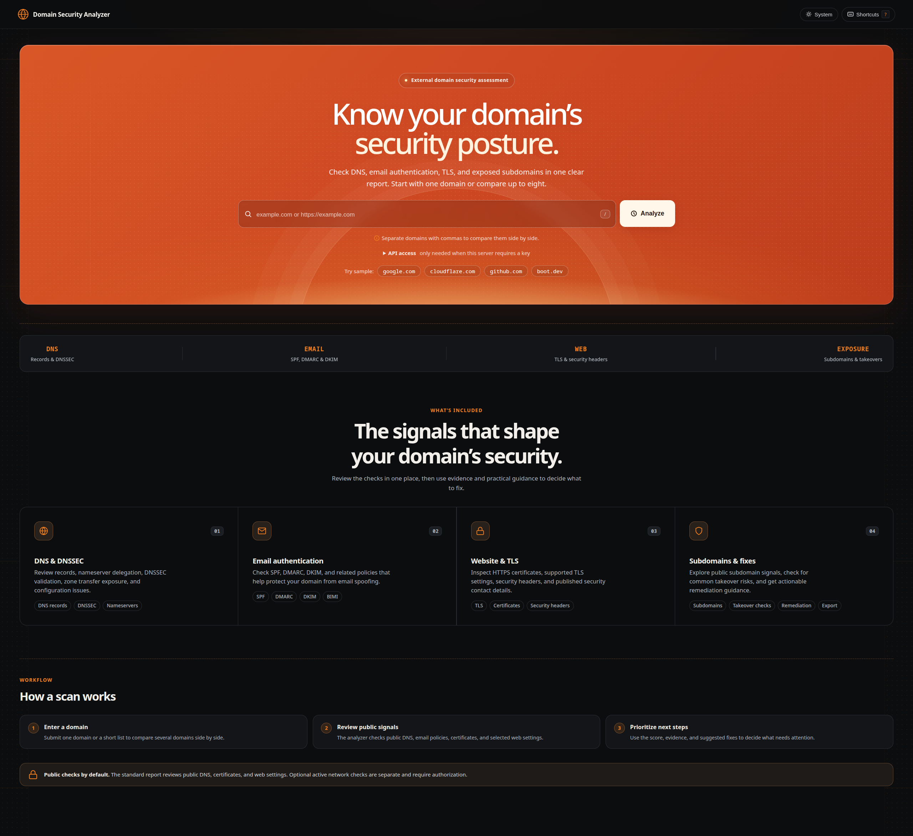

# Domain Security Analyzer

[](https://hub.docker.com/r/kanishkchahar/domain-security-analyzer)
[](LICENSE)

A self-hosted dashboard and command-line tool for reviewing a domain’s public DNS, email, DNSSEC, TLS, web security, and subdomain signals. It brings findings, evidence, scan coverage, and suggested DNS fixes together in one report.

**Use it only for domains and systems you own or are authorized to assess.** Results are point-in-time observations, not a penetration test or a guarantee of security.

## Screenshots

<a href="screenshots/01-landing.png"></a>

More views: [Overview](screenshots/02-overview.png) · [Findings](screenshots/03-findings.png) · [DNS](screenshots/04-dns.png) · [Email](screenshots/05-email.png) · [Security](screenshots/06-security.png) · [Web and TLS](screenshots/07-web-tls.png) · [Subdomains](screenshots/08-subdomains.png) · [Network](screenshots/09-network.png) · [Fix drafts](screenshots/10-fixes.png)

## Run locally

**Requirements:** Python 3.11 or newer, with the venv and pip modules available.

Clone the repository and start the app:

```bash
git clone https://github.com/Kanishkchahar/domain-security-analyzer.git
cd domain-security-analyzer
bash run.sh
```

The runner creates a local virtual environment and installs the application dependencies on the first launch. Then open <http://127.0.0.1:8000>. Press Ctrl+C in the terminal to stop the server.

To use a different port, pass it to the runner:

```bash
bash run.sh 9000
```

On Debian or Ubuntu, install the Python venv package if your Python installation does not include it: <code>sudo apt install python3-venv</code>. Nmap is optional for the additional service-identification mode.

## Run with Docker Hub

Docker must be installed and running. Pull the published version and start it on your own machine:

```bash
docker pull kanishkchahar/domain-security-analyzer:2.2.0
docker run --rm --name domain-security-analyzer \
  -p 127.0.0.1:8000:8000 \
  kanishkchahar/domain-security-analyzer:2.2.0
```

Open <http://127.0.0.1:8000>. Press Ctrl+C to stop and remove the container. To use the latest published image, replace the version tag with <code>latest</code>. The image is available on [Docker Hub](https://hub.docker.com/r/kanishkchahar/domain-security-analyzer).

To build and run the image from a local checkout instead:

```bash
docker build -t domain-security-analyzer:local .
docker run --rm --name domain-security-analyzer \
  -p 127.0.0.1:8000:8000 \
  domain-security-analyzer:local
```

The default Docker build runs the test suite before creating the runtime image. For another host port, change the left side of the port mapping, for example <code>127.0.0.1:9000:8000</code>. The loopback binding keeps the service local to your computer.

## Deploy to Vercel

The public demo is available at <https://domain-security-analyzer.vercel.app>. Visitors can run the standard DNS, email, TLS, and web checks without creating an account or entering an API key. Active TCP port scans and expanded directory scans are disabled on this deployment.

This repository is configured for Vercel’s Python runtime and FastAPI entrypoint. For your own public deployment, do not set `DNS_ANALYZER_API_KEYS` if you want visitors to scan without a shared key. Set `ENABLE_ACTIVE_PORT_SCAN=false` and `ENABLE_WIDE_DIRECTORY_SCAN=false`, and use conservative rate limits. This free deployment uses in-memory, per-instance limits, so they are best-effort rather than a global quota. See the [deployment and privacy notes](docs/DEPLOYMENT.md) before making an instance public.

Deploy from the project root with the Vercel CLI:

```bash
npm install --global vercel
vercel login
vercel
```

The first `vercel` deployment links this checkout to the selected Vercel project; Vercel may assign that first deployment to Production. Later `vercel` deployments create previews. After verifying a preview, publish it with:

```bash
vercel --prod
```

The app’s standard DNS, HTTP, and TLS checks run in the Vercel Function. Optional Nmap service identification and `ffuf` directory discovery require system executables that are installed in the Docker image but are not included in this Vercel deployment. Vercel instances are ephemeral, so in-memory caches and rate limits are best-effort and browser history remains in each user’s browser.

## What it checks

| Area | Examples |
|---|---|
| DNS | A, AAAA, MX, NS, TXT, CNAME, SOA and CAA records; DNSSEC delegation; nameserver consistency; wildcard DNS; zone-transfer exposure |
| Email | SPF, DMARC, DKIM, MTA-STS, TLS-RPT, BIMI, SMTP STARTTLS and mail-server reputation |
| Web and TLS | Certificates, negotiated TLS, protocol support, HTTP security headers, cookies and selected methods |
| Subdomains | Passive Certificate Transparency inventory and potential dangling CNAMEs |
| Network | DNS resolution, selected website paths and bounded TCP service checks |
| Reports | Findings and evidence, scan coverage, score explanation, suggested DNS changes, BIND export, JSON, SARIF and downloadable HTML |

The score is a rule-based summary. The report shows incomplete checks and warnings so a grade is not mistaken for certainty. Some checks can be inconclusive when a service or data source does not respond.

## CLI and API

The CLI uses the same scan pipeline as the dashboard:

```bash
bash run.sh --setup-only
./venv/bin/domain-security-analyzer example.com
./venv/bin/domain-security-analyzer example.com --json
./venv/bin/domain-security-analyzer example.com --sarif > findings.sarif
```

The main JSON endpoint is <code>POST /api/analyze</code>:

```bash
curl -X POST http://127.0.0.1:8000/api/analyze \
  -H 'Content-Type: application/json' \
  -d '{"domain":"example.com"}'
```

See the [API guide](docs/API.md) for other endpoints and the [scan guide](docs/scan.md) for check definitions and interpretation.

## Safety, privacy, and limitations

- Standard checks use public DNS and make bounded requests to related public services, including Certificate Transparency, RDAP, and RIPEstat. See [deployment and privacy notes](docs/DEPLOYMENT.md) for the outbound request details.
- Active TCP and expanded directory checks have separate server-side controls. Only run them against systems you are permitted to assess; the dashboard also asks you to confirm authorization.
- For a publicly reachable deployment, either require API keys or make an explicit public-access choice with conservative rate limits and optional checks disabled. In-memory limits are best-effort on serverless platforms. See the [deployment guide](docs/DEPLOYMENT.md).
- Browser scan history is stored in that browser. Short-lived scan caches and rate limits are held in the server process.
- DNSSEC chain validation is optional and informational. TLS checks sample protocol support and are not an exhaustive cipher or vulnerability audit. Certificate Transparency discovery is not a complete asset inventory.
- A possible takeover match is a candidate that needs manual verification. A scan result cannot prove that a domain is free of vulnerabilities.

## Project documentation

- [Scan guide](docs/scan.md): checks, scores, findings, and limitations.
- [API guide](docs/API.md): HTTP endpoints and examples.
- [Deployment and privacy](docs/DEPLOYMENT.md): configuration, authorization, outbound traffic, and operation.
- [Finding codes](docs/FINDING_CODES.md): stable finding identifiers.
- [Presentation guide](docs/PRESENTATION.md): demo and architecture notes.
- [Changelog](CHANGELOG.md) and [progress notes](PROGRESS.md).

## Development

The default Docker build includes an isolated test stage. To run the tests locally, install the development dependencies and run pytest:

```bash
python3 -m venv venv
./venv/bin/pip install -r requirements.txt -r requirements-dev.txt
./venv/bin/python -m pytest -q
```
